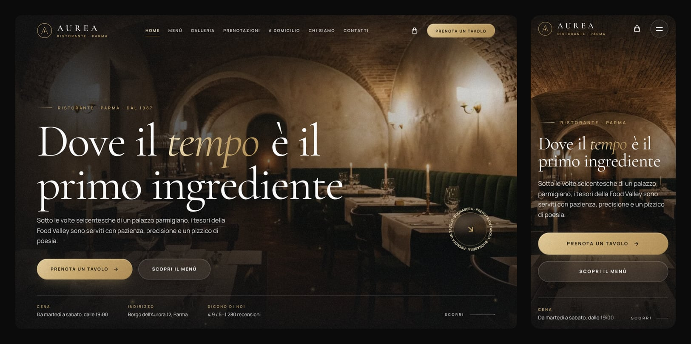

# Aurea — Ristorante · Parma

A premium, fully animated one-page website for a (fictional) fine-dining Italian restaurant.
Native **PHP + HTML5 + CSS3 + vanilla JavaScript** — no framework, no database, no build step.
The whole interface is written in **Italian**; this documentation and the code comments are in English.



> **Prototype.** The restaurant, its menu, prices and reviews are invented. Reservations, orders and
> newsletter subscriptions are simulated in the browser: nothing is stored or sent anywhere.

## What is in the page

| Section | What it does |
| --- | --- |
| **Home** | Full-screen hero with an entrance choreography, depth on scroll and pointer, drifting embers. |
| **About** | The story of the house, key figures that count up, the chef. |
| **Menu** | 30 dishes in six categories (Antipasti, Pasta, Pizza, Secondi, Dolci, Bevande) with animated filtering. Every dish can be added to the order. |
| **Gallery** | Draggable carousel and a full-screen lightbox (keyboard and swipe). |
| **Chef's Special** | The signature dish, with its own "add to order" button. |
| **Reservation** | Form with name, phone, email, number of guests, date, time, seating (indoor room or terrace: *Sala / Terrazza*) and comments. Live validation, an Italian calendar that greys out the closing days, time slots that follow the opening hours of the chosen day, and a confirmation dialog: *"La tua richiesta di prenotazione è stata ricevuta."* |
| **Delivery** | Delivery / take-away ordering: order board, cart drawer, quantities, delivery fee, free-delivery threshold, checkout confirmation. |
| **Reviews, FAQ** | Review carousel, accordion. |
| **Contact** | Address, phone, email, opening hours with an "open now" badge, stylised animated map. |

Also: loading screen, custom cursor and magnetic buttons (mouse only), smooth scrolling, scroll-driven
reveals, sticky header with scroll-spy, full-screen mobile navigation and a quick-actions dock on small
screens, toasts, gold confetti.

## Run it

Requirements: **PHP 7.4 or newer** (developed and tested with PHP 8.3). Nothing to install.

```bash
git clone https://github.com/HamdiSouissi/prototype-restaurant.git
cd prototype-restaurant
php -S localhost:8000
```

Then open <http://localhost:8000>. On a web host, upload the folder as it is: `index.php` is the entry
point and every asset is referenced with a relative path, so the site also works from a sub-folder.

Everything is self-hosted (fonts, scripts, icons, images): the page makes **no third-party request** and
works offline.

## Project structure

```
index.php                 The whole page: configuration, content, helpers, template
assets/
├── css/
│   ├── base.css          Fonts, design tokens (colours, type scale, spacing), reset, typography
│   ├── components.css    Buttons, tabs, chips, form fields, quantity control, small pieces
│   ├── layout.css        Loading screen, header, mobile navigation, footer, dock
│   ├── sections.css      One block per section, in reading order
│   ├── overlays.css      Cart drawer, dialogs, lightbox, toasts, confetti
│   └── vendor/           Swiper styles
├── js/
│   ├── main.js           Entry point: starts every feature (each one isolated from the others)
│   ├── modules/          One commented ES module per feature (see below)
│   └── vendor/           GSAP, ScrollTrigger, SplitText, Lenis, Swiper
├── fonts/                Cormorant Garamond and Manrope (variable, woff2) + their licences
├── icons/                SVG sprite and favicons
└── img/                  Responsive WebP images + manifest.json
docs/preview.jpg          The picture above
```

### JavaScript modules (`assets/js/modules/`)

| Module | Role |
| --- | --- |
| `libs.js`, `utils.js` | Access to the vendored libraries, small shared helpers |
| `scroll.js` | Smooth scrolling (Lenis) in sync with ScrollTrigger, anchor links, scroll lock |
| `overlay.js` | One manager for the drawer, the dialogs and the lightbox (focus trap, Escape) |
| `loader.js`, `hero.js`, `cursor.js`, `pointer.js` | Loading screen, hero, custom cursor, magnetic and tilt effects |
| `header.js` | Glass header, hide / show on scroll, active link, mobile navigation, dock |
| `scroll-effects.js` | Reveals, split headlines, parallax, counters, marquee |
| `filters.js` | Category filters of the menu and of the order board |
| `cart.js`, `toast.js`, `confetti.js` | Online order: cart, drawer, checkout, notifications |
| `reservation.js` | Reservation form: validation, time slots, confirmation |
| `datepicker.js` | Calendar of the date field: Italian, keyboard-operable, aware of the closing days |
| `gallery.js`, `accordion.js`, `contact.js`, `newsletter.js` | Carousels and lightbox, FAQ, opening status and map, newsletter |

## Make it yours

Everything editable sits at the top of `index.php`, as plain PHP arrays:

| Array | Content |
| --- | --- |
| `$site` | Name, address, phone, email, social links, rating |
| `$nav` | Navigation links |
| `$hours`, `$slots` | Opening hours and bookable times (they drive the timetable, the "open now" badge and the reservation form) |
| `$order` | Delivery fee, free-delivery threshold, preparation times |
| `$menu` | Categories (`label`, `motto`) and their dishes (`id`, `name`, `desc`, `price`, `tag`) |
| `$gallery`, `$stats`, `$reviews`, `$faq` | Gallery, key figures, reviews, questions |

**Images.** A dish uses the picture named after its `id`: `assets/img/menu/<id>-480.webp` and
`<id>-800.webp` (4:5). Every image is declared in `assets/img/manifest.json` with its available widths
(`w`), its aspect ratio (`r`, width ÷ height) and a placeholder colour (`c`); the PHP helper `img()`
builds the responsive `` from it.

**Icons.** `icon('name')` renders a symbol of `assets/icons/sprite.svg` (39 Remix Icon symbols). To use
another icon, add its `<symbol>` to the sprite.

**Colours and type.** The design tokens (gold, backgrounds, type scale, spacing, radii, easings) are
CSS custom properties at the top of `assets/css/base.css`.

### Language

The interface is in Italian (`<html lang="it">`), including what only a screen reader or a search engine
meets: labels of the controls, image descriptions, page metadata, structured data.

| Where | What |
| --- | --- |
| `index.php` | Everything printed in the page: the content arrays at the top, then the template |
| `assets/js/modules/` | Messages written by the scripts: `reservation.js` (validation), `cart.js` (cart, checkout, notifications), `newsletter.js`, `contact.js` (opening badge), `gallery.js` (carousel announcements), `header.js` (navigation button). `datepicker.js` holds no text: month and day names come from its `it-IT` locale |
| `assets/css/sections.css` | The "Oggi" marker of the timetable (generated content) |
| `assets/img/ui/map.svg` | Description of the map |

Numbers follow the Italian conventions — `24 €`, `4,50 €`, `4,9`, `1.280`, `Venerdì 13 novembre`. They
are produced by `number()` and `price()` in `index.php`, by `price()`, `money()` and `decimal()` in
`assets/js/modules/utils.js`, and dates by the `it-IT` locale. To translate the site, change the texts in
the four places above and these formats; the values used by the code (category slugs, `Indoor` /
`Terrace`, `data-*` attributes) stay as they are.

A native date field writes its format hint (`mm/dd/yyyy`, `gg/mm/aaaa`…) and its calendar in the language
of the *browser*, whatever the language of the page. The reservation form therefore brings its own
calendar (`datepicker.js`), which always speaks Italian. The native field stays in the form, hidden, and
keeps the value; without JavaScript it is simply used as it is.

### Connecting a real back end

The forms are complete on the front end; only the exchange with a server is simulated by a short timer.

- Reservation: `assets/js/modules/reservation.js`, the `submit` handler — replace the `setTimeout` with a
  `fetch()` to your endpoint and keep the code that opens the confirmation.
- Order: `assets/js/modules/cart.js`, the checkout handler — same principle. The cart lives in
  `sessionStorage`, so it survives a refresh and disappears when the tab is closed.
- Newsletter: `assets/js/modules/newsletter.js`.

## Quality notes

- **Responsive** from 320 px phones to large desktops; touch targets and a bottom dock on small screens.
- **Accessible**: semantic landmarks, keyboard navigation everywhere, focus trapped in dialogs and
  restored on close, labelled controls, live error messages, `prefers-reduced-motion` respected.
- **Robust**: without JavaScript the whole content stays readable (every dish and every answer is
  listed); each feature starts independently, so one failing never blocks the others.
- **Fast**: responsive WebP images with lazy loading and colour placeholders, self-hosted variable
  fonts, deferred scripts, animations paused while they are off screen.

Browser support: current versions of Chrome, Edge, Firefox and Safari.

## Credits and licences

| | |
| --- | --- |
| Typefaces | [Cormorant Garamond](https://github.com/CatharsisFonts/Cormorant) and [Manrope](https://github.com/sharanda/manrope) — SIL Open Font License 1.1 (texts in `assets/fonts/`) |
| Animation | [GSAP](https://gsap.com) with ScrollTrigger and SplitText — GSAP standard "no charge" licence |
| Smooth scrolling | [Lenis](https://github.com/darkroomengineering/lenis) — MIT |
| Carousels | [Swiper](https://swiperjs.com) — MIT |
| Icons | [Remix Icon](https://remixicon.com) — Remix Icon License |
| Photography | The dishes, the drinks and the vaulted dining room are original images generated for this prototype; the other photographs come from [Unsplash](https://unsplash.com) (Unsplash License) and were graded to match |

"Aurea", its address, its people and its reviews are fictional. Replace the photographs with pictures of
the real restaurant before any commercial use.
